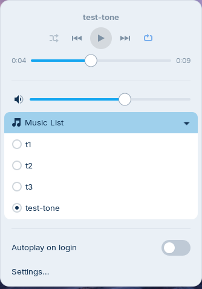

# Background Music Player

A GNOME Shell extension that plays your local music in the background from a
small menu in the top panel. No window, no separate app.



## Features

- **Panel menu:** track title, previous / play-pause / next, seek bar with
  elapsed and total time, loop (off / all / one) and shuffle.
- **Own volume:** independent of the system volume, with a mute button.
  Scroll on the panel icon to change it; middle-click the icon to play/pause.
- **Music List:** lists the audio files in your Music folder (optionally
  including subfolders). The folder is scanned only when you open the list.
- **Remembers everything:** last track, position, volume, loop and shuffle
  survive logout and reboot. After login the last track is ready, paused,
  where you left it.
- **Autoplay on login** (optional).
- **Keeps playing on the lock screen.**
- **MPRIS:** works with keyboard media keys, the media card in GNOME's
  notification list, and tools such as `playerctl`.
- Damaged or unsupported files are skipped with a notification.

## Requirements

- GNOME Shell 46 (Wayland or X11)
- GStreamer 1.x with the usual plugins. On Ubuntu/Debian-based systems:
  `gstreamer1.0-plugins-good` (FLAC, WAV, Ogg), `gstreamer1.0-plugins-ugly`
  and/or `gstreamer1.0-libav` (MP3, AAC/M4A, …)

## Install

From a release zip:

```bash
gnome-extensions install background-music-player@rahul.local.shell-extension.zip
```

Then log out and back in (required on Wayland for a newly installed
extension) and enable it:

```bash
gnome-extensions enable background-music-player@rahul.local
```

From source:

```bash
./scripts/install.sh   # compiles the schema and symlinks this folder
```

## Settings

Open **Settings…** at the bottom of the menu (or
`gnome-extensions prefs background-music-player@rahul.local`):

| Setting | Default |
|---|---|
| Music folder | your XDG Music folder (`~/Music`) |
| Include subfolders | off |
| Autoplay on login | off |
| Resume where you left off | on |

## How it works

```
gnome-shell process                         separate process
┌────────────────────────────────┐          ┌─────────────────────────────┐
│ extension.js                   │  stdin/  │ daemon/player-daemon.js     │
│  ├ lib/indicator.js  (menu)    │  stdout  │  GStreamer playbin          │
│  ├ lib/mpris.js      (D-Bus)   │◄────────►│  one JSON message per line  │
│  ├ lib/playlist.js, scanner.js │          └─────────────────────────────┘
│  └ GSettings (state)           │
└────────────────────────────────┘
```

**Why a separate process for playback?** On Wayland, gnome-shell is the
display server. A crash or a blocked main loop inside a decoder would end the
whole session. Playback therefore runs in a small `gjs` script shipped with
the extension (`daemon/player-daemon.js`), spawned with `Gio.Subprocess`. It
talks to the extension over its stdin/stdout pipes only. It needs no bus
name, network or privileges. It exits by itself when its stdin closes, so it
cannot outlive the shell. If it crashes it is restarted (up to 3 times).

## Notes for reviewers (extensions.gnome.org)

- **`session-modes: ["user", "unlock-dialog"]`.** Without this, music stops
  every time the screen locks. On the lock screen the panel button is hidden
  and its menu closed (`Indicator.syncSessionMode()`), so nothing of the
  extension is reachable there. Playback is the only thing that continues.
- **Lock-screen "rebase".** When the screen locks, GNOME disables the
  extensions that lack lock-screen support. To keep their order, it also
  disables and re-enables every extension enabled after them, which includes
  this one. To keep the music going through that cycle, `disable()` *while
  locked* hands the running player to a module-level variable instead of
  stopping it. The `enable()` that follows immediately picks it up again. If no
  `enable()` follows within 10 s, a timer stops the player
  (`extension.js`, `park()`).
- **Timers that outlive `disable()`:** the 10 s timer above, and a 1 s timer
  in `PlayerClient.destroy()`. That one force-kills the playback process only
  if it did not quit by itself after being asked to and having its stdin
  closed. All other signals and sources are disconnected in `disable()`.
- **Private API:** `Main.layoutManager._startingUp` is used to tell a login
  (autoplay allowed) from a manual enable (never autoplays).
- `Gio._promisify()` is called at module scope in `lib/scanner.js`, the same
  way GNOME Shell does it.
- `console.log` is used for three rare events only: an autoplay retry, a
  forgotten missing track, and giving up after repeated errors.

## Development

| Task | Command |
|---|---|
| Install from source | `./scripts/install.sh` |
| Nested Wayland session | `./scripts/nested.sh`, then enable the extension inside it |
| Shell logs | `journalctl -f -o cat /usr/bin/gnome-shell` |
| Run the playback process alone | `gjs -m daemon/player-daemon.js`, then type e.g. `{"cmd":"load","uri":"file:///path/song.mp3"}` |
| Build the zip | `./scripts/pack.sh` → `dist/` |

The development plan and progress are tracked in [PLAN.md](PLAN.md).

## License

GPL-2.0-or-later. See [LICENSE](LICENSE).
